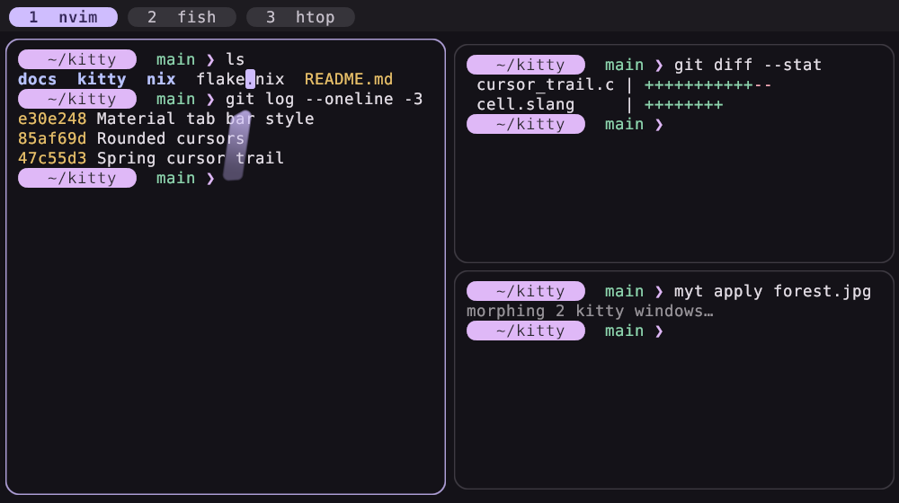
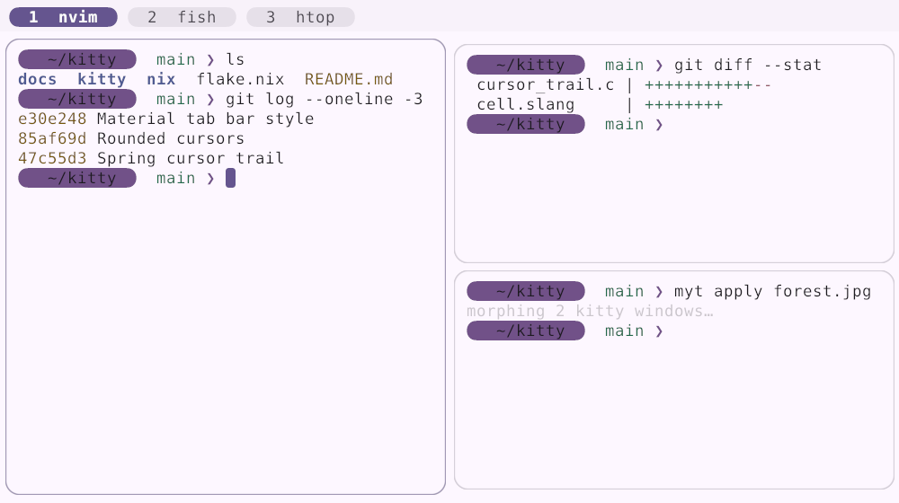
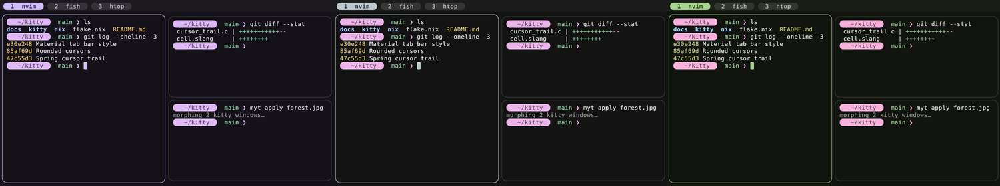
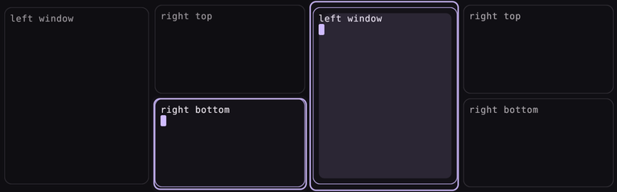

# Kitty Material You

Форк терминала [kitty](https://github.com/kovidgoyal/kitty) в стиле **Material You
(Material Design 3)**: пружинная физика анимаций, фигуры M3 (скруглённый курсор,
вкладки-«таблетки», окна-карточки), нативный плавный морфинг цветов и набор Material
шейдеров. Ставится через Nix flake и работает в паре с
[Material-You-Terminal](https://github.com/Kostr2007/Material-You-Terminal): палитра из
обоев → kitty, fish, starship, fastfetch.

*A fork of the kitty terminal with Material Design 3 motion and shapes: spring physics,
a jelly cursor trail, rounded cursors, pill shaped tabs, native color morphing and
Material shaders. Ships as a Nix flake and integrates with Material-You-Terminal.*





## Что нового по сравнению с kitty

| | |
|---|---|
| **Пружины (spring)** | Новая функция плавности `spring(damping[, stiffness])` и токены движения M3: `m3-standard`, `m3-emphasized`, `m3-emphasized-decelerate`, `m3-spring`, `m3-spring-bouncy`, `m3-expressive-fast`, `m3-effects-default` и др. Работают везде, где kitty принимает easing: мигание курсора, визуальный звонок, `animation_curve` в шейдерах (там пружина может «перелетать» цель). |
| **Желейный след курсора** | `cursor_trail_spring`: углы следа двигаются по физике затухающей пружины (точное решение уравнения, стабильно при любом FPS). Передние углы жёстче, задние мягче, поэтому след тянется и пружинит как желе. |
| **Фигуры курсора** | `cursor_corner_radius`: блочный курсор становится скруглённым прямоугольником или «таблеткой» (рисуется в шейдере между фоном и текстом, со сглаживанием), у beam/underline — закруглённые концы, у hollow — скруглённый контур. |
| **Вкладки M3** | `tab_bar_style material`: каждая вкладка — отдельная «таблетка», активная залита цветом `active_tab_background` (primary). |
| **Морфинг цветов** | `color_transition 0.5 m3-spring-effects`: при `kitten @ set-colors`, `myt apply` или переключении светлой/тёмной темы все окна, вкладки и рамки плавно перетекают в новую палитру в пространстве OKLab, 60 кадров/с прямо внутри kitty. |
| **Material шейдеры** | `custom_shaders material-you`: «желейный» скруглённый след курсора цвета primary, рябь (ripple) от клика как на Android и пружинящий индикатор фокуса при переключении окон. Можно включать по отдельности: `m3-cursor-trail`, `m3-ripple`, `m3-focus`. |
| **Готовый стиль** | `extras/material-you.conf` и темы `extras/themes/material-you-{dark,light}.conf` (базовая схема M3), или всё одной строкой в home-manager. |

Плавный морфинг из фиолетовой палитры в зелёную после `myt apply` (было, середина
перехода, стало):



Индикатор фокуса (пружинящий контур) и рябь от клика:



## Установка

### Nix flake (NixOS / home-manager)

```nix
# flake.nix
{
  inputs = {
    nixpkgs.url = "github:NixOS/nixpkgs/nixos-unstable";
    home-manager.url = "github:nix-community/home-manager";
    home-manager.inputs.nixpkgs.follows = "nixpkgs";

    kitty-material-you.url = "github:Kostr2007/Kitty-Material-You";
    kitty-material-you.inputs.nixpkgs.follows = "nixpkgs";
  };
}
```

**NixOS + home-manager как модуль NixOS** (Material-You-Terminal подключается
автоматически, отдельно его импортировать не нужно):

```nix
outputs = { nixpkgs, home-manager, kitty-material-you, ... }: {
  nixosConfigurations.my-pc = nixpkgs.lib.nixosSystem {
    system = "x86_64-linux";
    modules = [
      ./configuration.nix
      home-manager.nixosModules.home-manager
      kitty-material-you.nixosModules.default

      ({ pkgs, ... }: {
        programs.kitty-material-you.enable = true;   # kitty, myt, fish, шрифт
        users.users.kostr.shell = pkgs.fish;

        home-manager.users.kostr = {
          programs.kitty-material-you.enable = true;
          # Палитра от Material-You-Terminal: из обоев или из цвета
          programs.material-you-terminal.source.image = ./wallpapers/current.jpg;
        };
      })
    ];
  };
};
```

**Только home-manager:**

```nix
homeConfigurations.kostr = home-manager.lib.homeManagerConfiguration {
  pkgs = nixpkgs.legacyPackages.x86_64-linux;
  modules = [
    kitty-material-you.homeManagerModules.default   # уже включает модуль Material-You-Terminal
    { programs.kitty-material-you.enable = true; }
  ];
};
```

Если модуль Material-You-Terminal у вас уже импортирован отдельно, используйте
`kitty-material-you.homeManagerModules.kitty-material-you` вместо `default`
(иначе опции объявятся дважды).

**Просто попробовать:** `nix run github:Kostr2007/Kitty-Material-You`.
Пакет также доступен как `packages.<system>.default` и через `overlays.default`
(`pkgs.kitty-material-you`).

### Без Nix

Сборка такая же, как у kitty (см. [docs/build.rst](docs/build.rst)), понадобится
`slangc` ([shader-slang](https://github.com/shader-slang/slang)):

```sh
python3 setup.py linux-package     # результат в ./linux-package
cp extras/material-you.conf ~/.config/kitty/
mkdir -p ~/.config/kitty/themes && cp extras/themes/*.conf ~/.config/kitty/themes/
```

и в `~/.config/kitty/kitty.conf`:

```conf
include material-you.conf
include themes/material-you-dark.conf
```

## Настройки home-manager

```nix
programs.kitty-material-you = {
  enable = true;

  shapes.enable = true;                       # курсор, окна-карточки, вкладки-таблетки, скроллбар
  shapes.cursorCornerRadius = 0.3;            # 0.5 — курсор-«таблетка»
  shapes.windowCornerRadius = "12pt";

  motion.enable = true;                       # пружины
  motion.cursorTrailSpring = "m3-expressive-fast";   # или "700 0.7" (жёсткость, коэфф. затухания), "none"
  motion.colorTransition = "0.5 m3-spring-effects";  # "0" — без морфинга

  shaders = [ "material-you" ];               # [ "m3-cursor-trail" "m3-ripple" ], [] — выключить

  theme = "dark";                             # своя тема, только если цвета не от Material-You-Terminal
  materialYouTerminal.enable = true;          # палитра из обоев через myt
};
```

Любую настройку можно переопределить обычным `programs.kitty.settings`: значения
модуля имеют пониженный приоритет.

## Новые опции kitty.conf

```conf
# Скругление курсора в долях ширины ячейки (0 — квадратный, 0.5 — «таблетка»)
cursor_corner_radius 0.3

# Пружинный след курсора: токен M3 или «жёсткость коэффициент_затухания»
cursor_trail 1
cursor_trail_spring m3-expressive-fast

# Морфинг цветов при смене палитры: длительность и easing
color_transition 0.5 m3-spring-effects

# Вкладки-таблетки
tab_bar_style material

# Пружины и токены M3 везде, где есть easing
cursor_blink_interval 0.6 m3-spring-effects
visual_bell_duration 0.3 spring(0.8)

# Material шейдеры
custom_shaders material-you
```

Полный список функций плавности — в разделе *easing function* в
[docs/glossary.rst](docs/glossary.rst), шейдеры — в
[docs/custom-shaders.rst](docs/custom-shaders.rst) (раздел *Material You*).

## Как работает связка с Material-You-Terminal

```
обои/цвет ─► matugen (myt) ─► палитра M3 ─► kitty.conf с цветами ─► kitty-material-you
                                                       │
                     myt apply ─► один set-colors ─────┘─► kitty сам плавно морфит цвета
```

* Material-You-Terminal генерирует палитру и цвета для kitty, fish, starship и fastfetch.
* Модуль kitty-material-you ставит наш kitty как `programs.kitty.package`, включает
  фигуры и пружины поверх настроек Material-You-Terminal и выставляет
  `animations.transitionMs = 0`: `myt` отправляет новую палитру одной командой, а
  анимацию (OKLab, пружина, 60 к/с) делает сам kitty, без десятков команд по сокету.
* Цвет курсора = `primary`, поэтому след курсора, рябь и индикатор фокуса автоматически
  перекрашиваются вместе с обоями.

## Обновление до новой версии kitty

История kitty сохранена, поэтому обновление — это обычный merge:

```sh
git remote add upstream https://github.com/kovidgoyal/kitty
git fetch upstream tag v0.50.0 --no-tags
git merge v0.50.0
```

Если изменились `go.mod`/`go.sum`, обновите `vendorHash` в `nix/package.nix`.

## Разработка

```sh
nix develop                       # все зависимости сборки
python3 setup.py build            # собрать в дереве
python3 test.py                   # тесты kitty (включая новые)
./kitty/launcher/kitty +launch gen/config.py   # после изменения kitty/options/definition.py
nix flake check                   # сборка пакета с тестами и проверка конфигов
```

Новый код: `kitty/animation.c` (пружины), `kitty/cursor_trail.c` (физика следа),
`kitty/shaders/cell.slang` и `kitty/decorations.c` (фигуры курсора), `kitty/tab_bar.py`
(вкладки), `kitty/color_transition.py` (морфинг), `kitty/shaders/custom/m3-*.slang`
(шейдеры), `nix/` и `extras/`.

## Лицензия

GPL-3.0, как и kitty. Kitty Material You основан на
[kitty](https://github.com/kovidgoyal/kitty) © Kovid Goyal и контрибьюторы.
